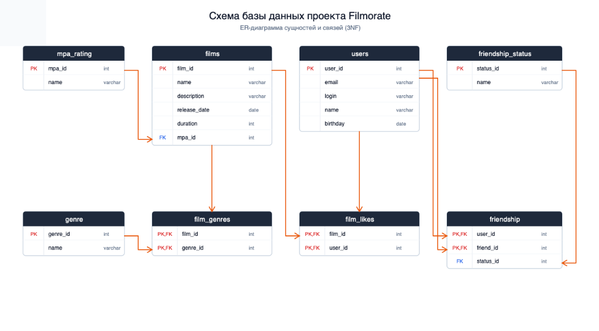

# Схема базы данных Filmorate



## Описание структуры базы данных

Схема спроектирована в соответствии с третьей нормальной формой (3NF):
- Каждый столбец хранит только одно атомарное значение.
- Все неключевые атрибуты однозначно определяются первичным ключом.
- Неключевые атрибуты не зависят от других неключевых атрибутов.

### Таблицы и связи

1. **`films`** — содержит сведения о фильмах:
   - `id` (BIGINT, PRIMARY KEY) — идентификатор фильма;
   - `name` (VARCHAR) — название фильма;
   - `description` (VARCHAR) — описание фильма;
   - `release_date` (DATE) — дата выхода;
   - `duration` (INTEGER) — продолжительность в минутах;
   - `mpa_id` (BIGINT, FOREIGN KEY) — внешний ключ, указывает на `mpa_rating.id`.

2. **`mpa_rating`** — справочник возрастных рейтингов Ассоциации кинокомпаний (МРА):
   - `id` (BIGINT, PRIMARY KEY) — идентификатор рейтинга;
   - `name` (VARCHAR) — код рейтинга (G, PG, PG-13, R, NC-17).

3. **`genre`** — справочник жанров:
   - `id` (BIGINT, PRIMARY KEY) — идентификатор жанра;
   - `name` (VARCHAR) — наименование (Комедия, Драма, Мультфильм, Триллер, Документальный, Боевик).

4. **`film_genres`** — соединительная таблица связи «многие ко многим» для фильмов и их жанров:
   - `film_id` (BIGINT, PRIMARY KEY, FOREIGN KEY) — внешний ключ к таблице `films`;
   - `genre_id` (BIGINT, PRIMARY KEY, FOREIGN KEY) — внешний ключ к таблице `genre`.

5. **`users`** — содержит сведения о пользователях:
   - `id` (BIGINT, PRIMARY KEY) — идентификатор пользователя;
   - `email` (VARCHAR) — электронная почта;
   - `login` (VARCHAR) — логин пользователя;
   - `name` (VARCHAR) — имя для отображения;
   - `birthday` (DATE) — дата рождения.

6. **`film_likes`** — соединительная таблица связи «многие ко многим» для отметок «мне нравится»:
   - `film_id` (BIGINT, PRIMARY KEY, FOREIGN KEY) — внешний ключ к таблице `films`;
   - `user_id` (BIGINT, PRIMARY KEY, FOREIGN KEY) — внешний ключ к таблице `users`.

7. **`friendship`** — таблица связи «дружба» (односторонняя) между пользователями:
   - `user_id` (BIGINT, PRIMARY KEY, FOREIGN KEY) — пользователь, который добавил в друзья;
   - `friend_id` (BIGINT, PRIMARY KEY, FOREIGN KEY) — пользователь, которого добавили в друзья.

## Примеры запросов для основных операций приложения

### 1. Получение всех фильмов
```sql
SELECT f.id,
       f.name,
       f.description,
       f.release_date,
       f.duration,
       f.mpa_id,
       m.name AS mpa_name
FROM films AS f
LEFT JOIN mpa_rating AS m ON f.mpa_id = m.id;
```

### 2. Получение фильма по идентификатору
```sql
SELECT f.id,
       f.name,
       f.description,
       f.release_date,
       f.duration,
       f.mpa_id,
       m.name AS mpa_name
FROM films AS f
LEFT JOIN mpa_rating AS m ON f.mpa_id = m.id
WHERE f.id = 1;
```

### 3. Получение жанров фильма
```sql
SELECT g.id,
       g.name
FROM genre AS g
JOIN film_genres AS fg ON g.id = fg.genre_id
WHERE fg.film_id = 1;
```

### 4. Получение всех пользователей
```sql
SELECT u.id,
       u.email,
       u.login,
       u.name,
       u.birthday
FROM users AS u;
```

### 5. Получение пользователя по идентификатору
```sql
SELECT u.id,
       u.email,
       u.login,
       u.name,
       u.birthday
FROM users AS u
WHERE u.id = 1;
```

### 6. Топ N наиболее популярных фильмов по количеству лайков
```sql
SELECT f.id,
       f.name,
       f.description,
       f.release_date,
       f.duration,
       m.name AS mpa_name,
       COUNT(fl.user_id) AS likes_count
FROM films AS f
LEFT JOIN mpa_rating AS m ON f.mpa_id = m.id
LEFT JOIN film_likes AS fl ON f.id = fl.film_id
GROUP BY f.id,
         f.name,
         f.description,
         f.release_date,
         f.duration,
         m.name
ORDER BY likes_count DESC, f.id ASC
LIMIT 10;
```

### 7. Получение списка друзей пользователя
```sql
SELECT u.id,
       u.email,
       u.login,
       u.name,
       u.birthday
FROM users AS u
JOIN friendship AS f ON u.id = f.friend_id
WHERE f.user_id = 1
ORDER BY u.id;
```

### 8. Получение списка общих друзей с другим пользователем
```sql
SELECT u.id,
       u.email,
       u.login,
       u.name,
       u.birthday
FROM users AS u
JOIN friendship AS f1 ON u.id = f1.friend_id
JOIN friendship AS f2 ON u.id = f2.friend_id
WHERE f1.user_id = 1
  AND f2.user_id = 2
ORDER BY u.id;
```
